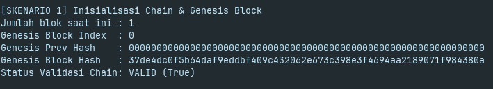
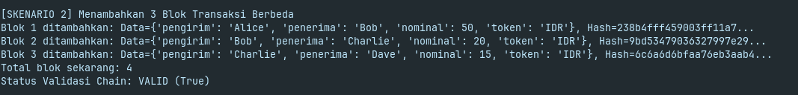
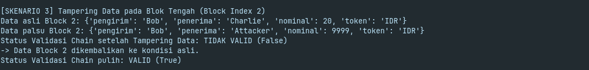
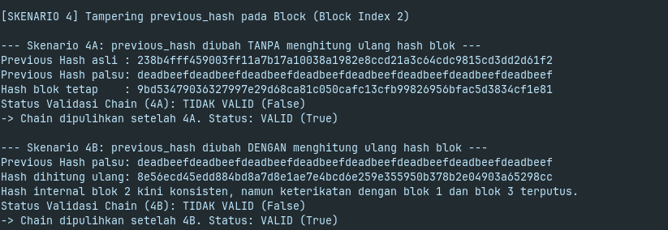
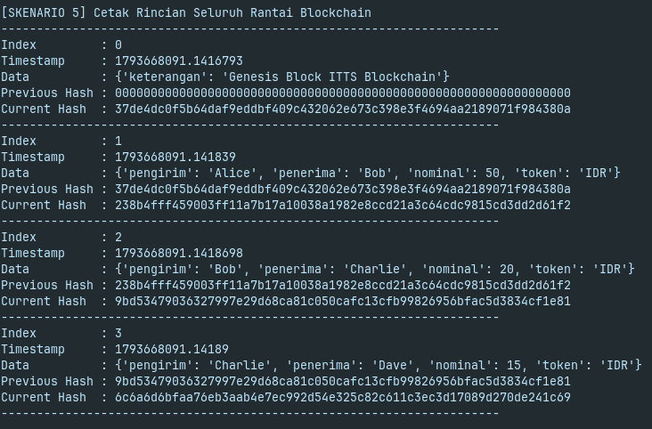

# Tugas 4: Implementasi Blockchain Sederhana dengan Python

**Mata Kuliah:** IF219 Teknologi Blockchain  
**Program Studi:** S1 Teknologi Informasi  
**Institusi:** Institut Teknologi Tangerang Selatan (ITTS)  
**Nama Mahasiswa:** Rafael Bramantyo Buana Putra  
**NIM:** 1002240003  
**Pertemuan:** 6 (Tugas Mandiri / Individu - Bobot 5%)  

---

## 1. Desain Arsitektur & Struktur Program

Program ini mengimplementasikan struktur dasar blockchain menggunakan pustaka standar Python (`hashlib`, `json`, `time`) tanpa dependensi eksternal berat.

### A. Class `Block`
Merepresentasikan satu unit blok dalam rantai data dengan atribut:
- `index` (int): Nomor urut blok dalam rantai (dimulai dari 0 untuk Genesis Block).
- `timestamp` (float): Waktu pencatatan pembuatan blok dalam format epoch timestamp.
- `data` (dict/any): Muatan transaksi atau payload data yang disimpan.
- `previous_hash` (str): Hash SHA-256 dari blok sebelumnya yang mengikat relasi rantai.
- `nonce` (int): Nilai acak pembantu proof-of-work (default: 0).
- `hash` (str): Hash SHA-256 yang dihitung secara deterministik dari isi blok.

Fungsi `calculate_hash()` menggunakan:
```python
payload = {
    "index": self.index,
    "timestamp": self.timestamp,
    "data": self.data,
    "previous_hash": self.previous_hash,
    "nonce": self.nonce
}
raw = json.dumps(payload, sort_keys=True).encode()
return hashlib.sha256(raw).hexdigest()
```
Penggunaan `sort_keys=True` menjamin representasi string JSON berurutan konsisten dan deterministik saat dihitung hash-nya.

### B. Class `Blockchain`
Mengelola rantai blok dan mekanisme konsistensi ledger:
- `__init__()`: Otomatis memanggil `create_genesis_block()`.
- `create_genesis_block()`: Menciptakan blok pertama (index 0) dengan `previous_hash` berisi 64 karakter `0`.
- `latest_block()`: Mengambil referensi blok terkini (`self.chain[-1]`).
- `add_block(data)`: Membentuk blok baru dengan mengikat `previous_hash` dari hash blok terkini.
- `is_valid()`: Melakukan audit integritas menyeluruh terhadap seluruh rantai:
  1. Memverifikasi integritas Genesis block (index 0, previous_hash 64 nol, hash valid).
  2. Memverifikasi hash internal setiap blok (`current.hash == current.calculate_hash()`).
  3. Memverifikasi keterikatan relasi antarblok (`current.previous_hash == previous.hash`).

---

## 2. Cara Menjalankan Script

Program ini dibangun murni menggunakan pustaka standar Python 3 (`hashlib`, `json`, `time`), sehingga tidak memerlukan dependensi eksternal tambahan.

### Menjalankan via Terminal / CLI
Pastikan Python 3 sudah terinstal di sistem Anda, kemudian jalankan perintah berikut dari direktori proyek:
```bash
python3 blockchain.py
```

### Menjalankan di Google Colab / Jupyter Notebook
1. Buka [Google Colab](https://colab.research.google.com).
2. Upload file notebook `1002240003_Rafael_Bramantyo_Buana_Putra_Tugas4_Implementasi_Blockchain_Python.ipynb` atau copy-paste isi `blockchain.py` ke cell notebook baru.
3. Jalankan cell secara berurutan (`Shift + Enter`). Output eksekusi kelima skenario pengujian akan langsung muncul di bawah cell.

---

## 3. Hasil Pengujian Skenario Wajib

Program menyertakan fungsi pengujian otomatis `run_tests()` yang menguji 5 skenario sesuai rubrik evaluasi:

| No | Skenario Uji | Tindakan / Kondisi | Expected Behavior | Status |
|:--:|:---|:---|:---:|:---:|
| 1 | Inisialisasi Genesis Block | Chain baru diinisialisasi otomatis hanya dengan genesis block | **Valid (True)** | Terpenuhi |
| 2 | Penambahan Blok Transaksi | Menambahkan minimal 3 blok dengan payload transaksi berbeda | **Valid (True)** | Terpenuhi |
| 3 | Tampering Data Blok Tengah | Memodifikasi data transaksi pada Block Index 2 tanpa update hash | **Tidak Valid (False)** | Terpenuhi |
| 4A | Tampering `previous_hash` (Tanpa Update Hash) | Mengubah `previous_hash` Blok 2 tanpa menghitung ulang hash internal | **Tidak Valid (False)** | Terpenuhi |
| 4B | Tampering `previous_hash` (Dengan Update Hash) | Mengubah `previous_hash` Blok 2 dan menghitung ulang hash internal Blok 2 | **Tidak Valid (False)** | Terpenuhi |
| 5 | Inspeksi Struktur Rantai | Mencetak `index`, `timestamp`, `data`, `previous_hash`, dan `hash` | Keterkaitan terlihat | Terpenuhi |

---

## 4. Analisis Ilmiah: Mengapa Tampering Dapat Dideteksi?

Mekanisme integritas data pada blockchain dibangun di atas empat pilar kriptografis:

1. **Hash Deterministik dari Isi Blok:**  
   Seluruh atribut blok diserialisasi menggunakan `json.dumps(..., sort_keys=True)`. Format kunci yang terurut secara alfabetis memastikan urutan representasi data selalu identik. Dengan demikian, fungsi SHA-256 selalu menghasilkan nilai hash digest yang deterministik untuk isi blok yang sama.

2. **Avalanche Effect (Efek Longsoran Salju) SHA-256:**  
   Fungsi hash satu arah SHA-256 memiliki karakteristik *avalanche effect*. Perubahan sekecil apa pun pada data transaksi (bahkan perbedaan satu spasi, huruf besar/kecil, atau 1 bit data) akan mengubah seluruh digest hash secara radikal dan acak. Tidak ada korelasi visual antara nilai hash sebelum dan sesudah perubahan data.

3. **Komparasi Nilai Hash pada `is_valid()`:**  
   Fungsi validasi `is_valid()` menghitung ulang hash dari seluruh isi blok secara real-time (`current.calculate_hash()`) lalu membandingkannya langsung dengan hash tersimpan pada atribut blok (`current.hash`). Jika penyerang mengubah data transaksi pada blok tengah tanpa menghitung ulang hash (Skenario 3 dan Skenario 4A), kondisi `current.hash != current.calculate_hash()` langsung terpenuhi dan sistem secara instan menyatakan rantai **Tidak Valid (`False`)**.

4. **Keterikatan Kriptografis Rantai (`previous_hash`):**  
   Atribut `previous_hash` bertindak sebagai rantai digital yang mengunci blok saat ini dengan identitas kriptografis blok sebelumnya. Apabila penyerang memperbarui hash internal blok tengah agar valid secara internal (Skenario 4B), nilai hash blok tersebut pasti berubah. Perubahan ini mengakibatkan `previous_hash` pada blok berikutnya (Blok 3) tidak lagi cocok dengan hash Blok 2 (`current.previous_hash != previous.hash`). Mengubah satu blok secara otomatis memutus keabsahan rantai seluruh blok setelahnya (*broken chain*).

---

## 5. Bukti Pengujian

Berikut adalah dokumentasi tangkapan layar hasil eksekusi program untuk masing-masing skenario pengujian (tersimpan pada folder `screenshots/`):

- **Skenario 1 (Inisialisasi Genesis Block):**  
    
  *Genesis block otomatis terbuat dengan index 0, previous_hash 64 nol, dan status valid.*

- **Skenario 2 (Penambahan 3 Blok Transaksi):**  
    
  *Tiga blok transaksi berhasil ditambahkan dan rantai berstatus valid.*

- **Skenario 3 (Tampering Data Blok Tengah):**  
    
  *Modifikasi data transaksi pada Blok 2 terdeteksi dan menghasilkan status False.*

- **Skenario 4 (Tampering previous_hash - Varian 4A & 4B):**  
    
  *Pengujian pemutusan hash baik tanpa maupun dengan rekalkulasi hash internal keduanya terdeteksi False.*

- **Skenario 5 (Inspeksi Seluruh Rantai Blockchain):**  
    
  *Rincian seluruh blok tercetak lengkap membuktikan keterikatan relasi rantai hash.*

Log output teks lengkap hasil eksekusi terminal tersimpan pada: [`screenshots/output_pengujian.txt`](screenshots/output_pengujian.txt).
